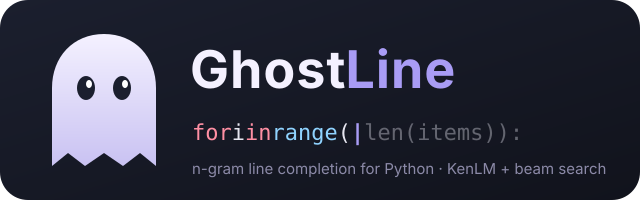

<p align="center">
  
</p>

# GhostLine

**Line completion for Python with a KenLM n-gram model and beam search.**
You type the start of a line; GhostLine proposes the rest as "ghost text",
and stays silent when it isn't confident.

```text
$ uv run python -m autocomplete.complete "with open(path"
typed:      with open(path
best guess: ) as f:
confidence: 0.25 (threshold 0.1) -> shown as ghost text   [23.6 ms]

$ uv run python -m autocomplete.complete "for i in range("
typed:      for i in range(
best guess: n):
confidence: 0.02 (threshold 0.1) -> silent: not confident enough   [8.8 ms]
```

This is a learning project, built step by step to understand how
autocomplete systems like Gmail Smart Compose or editor completions are put
together: data, tokenization, a language model, decoding, honest evaluation
and latency.

---

## Results

Settings were chosen on the **validation** split, then measured **once** on the
held-out **test** split (code from 50 packages the model never saw).

| Model (test) | Perplexity ↓ | Next-token acc@1 | acc@5 | Full-line exact | Suggestible exact | Latency p50 / p95 |
|---|---|---|---|---|---|---|
| Unigram baseline | 92.4 | 12.5% | 44.1% | 0.0% | 0.0% | 4 / 5 ms |
| Bigram baseline | 25.9 | 33.2% | 65.5% | 2.5% | 10.0% | 8 / 9 ms |
| **GhostLine: KenLM 6-gram, beam 4** | **10.9** | **52.2%** | **75.0%** | **12.6%** | **19.1%** | **22 / 91 ms** |

With the confidence threshold (0.1) GhostLine suggests something for **41%** of
cursor positions, and **35%** of those suggestions are exactly right (vs 17%
right if it always suggested).

| Breakdown (test, suggestible exact) | |
|---|---|
| Completion is 1-3 tokens / 4-7 / 8+ | 45.3% / 11.1% / 5.4% |
| Package has a relative in train (e.g. `pydantic_core` ~ `pydantic`) / unrelated | 24.1% / 18.3% |
| Bonus: the author's own projects (never trained on) | 25.3% |

**Ceiling.** Our rules make some lines impossible to complete in full: only
52.6% of test targets contain no unknown name or literal, and in 15.8% of cases
the correct behaviour is to stay silent. See [Decoding rules](#decoding-rules).

All numbers are in [`results/`](results/).

---

## How it works

```text
  Python files ──► collect ─► dedupe ─► filter ─► split by package ─► tokenize (+ vocab)
                                                                            │
  data/eval: 2,000 frozen cursor positions per split ◄──────────────────────┤
                                                                            ▼
  code before the cursor ──► KenLM 6-gram ──► beam search + rules ──► confidence ≥ 0.1 ? ──► ghost text
```

### 1. Data: 123,043 files → 15,844 clean files

Python source already on the machine: the standard library, the
`site-packages` of 12 project virtualenvs, and the author's own projects.

| Step | Files left | What it removed and why |
|---|---|---|
| Collect | 123,043 | |
| Dedupe (content hash) | 37,336 | **70% were copies**: many venvs install the same libraries |
| Filter | 15,844 | **9,784 machine-generated files** (OpenAPI/Stainless SDKs, protobuf...) that would inflate scores, 445 too-big files, 66 empty files, and a cap of 300 files per package so `torch` can't dominate |

**Split by package, not by file.** If `torch/nn/linear.py` were in train and
`torch/nn/conv.py` in test, the test would measure "torch memory". Whole
packages are held out instead: 80/10/10 of code size → 412 / 55 / 59 packages
(22.2M / 2.6M / 2.8M tokens). The author's own code is a separate test set.

### 2. Tokens: Python's own tokenizer

Python ships a perfect tokenizer for itself (`tokenize`). Both the model and
the evaluation read the same normalized tokens:

```text
def load(path, retries=3):          def load ( path , <unk> = 3 ) : <EOL>
    with open(path, encoding=...    <INDENT> with open ( path , encoding = "utf-8" ) ...
```

| Token | Becomes | Why |
|---|---|---|
| names, operators | themselves | the core of code |
| end of a logical line | `<EOL>` | the stop signal for line completion |
| indentation | `<INDENT>` / `<DEDENT>` | block structure |
| comments, blank lines | dropped | prose and layout, not code |
| strings, numbers | kept if common, short and space-free, else `<STR>` / `<NUM>` | most literals are unpredictable |
| names outside the 20,000-token vocabulary | `<unk>` | closed vocabulary |

The vocabulary is built from **train only**. Its OOV rate on unseen packages
stays around 10% even at 50,000 tokens: each package brings its own names
(the "localness of software", Tu et al. 2014). No global vocabulary fixes that.

### 3. The model: KenLM with Kneser-Ney smoothing

An n-gram model predicts the next token from the previous *n−1* tokens by
counting, e.g. `P( ( | for i in range )`. Kneser-Ney smoothing (Kneser & Ney,
1995) gives probability to sequences never seen in training, using how many
*different* contexts a token appears in. [KenLM](https://github.com/kpu/kenlm)
(Heafield, 2011) builds and queries these models fast.

| n (val) | Perplexity | acc@1 | Full-line exact | Suggestible exact |
|---|---|---|---|---|
| 3 | 13.0 | 43.9% | 11.5% | 17.2% |
| 4 | 11.7 | 49.4% | 13.2% | 19.4% |
| 5 | 10.8 | 53.1% | 15.4% | 21.1% |
| **6** | **10.5** | **54.2%** | **16.7%** | **21.8%** |

Longer context keeps helping but with diminishing returns: each extra token of
context is seen less often, so the counts get sparse. A 6-gram is 141 MB and
builds in under a minute.

Two details that were easy to get wrong:
- **`<unk>` in training text:** KenLM reserves `<unk>` and refuses it in the corpus.
  Its suggested `--skip_symbols` deletes the token and glues its neighbours
  together, creating n-grams that never existed. GhostLine renames it to
  `<oov>`, an ordinary word, so the model learns where unknown names appear.
- **log10 vs ln:** KenLM scores are base-10 logs; the harness converts them.

### 4. Beam search

A language model only answers "what is the next token?". To suggest a whole
line we chain that question, and must decide which path to follow.

- **Greedy** keeps the single best token at each step and can never undo an
  early choice.
- **Trying everything** means 20,000¹⁵ lines: impossible.
- **Beam search** keeps the *B* best partial lines. At each step every beam is
  extended, **all** extensions compete in one pool, and the best *B* survive.
  A path that starts slightly worse can still win; paths that collapse are
  dropped.

Picture a student collecting toffees room by room. Greedy grabs the biggest
pile in each room and never finds the 9-toffee room behind the smaller door.
Beam search sends *B* students, and after every room keeps the *B* best totals
so far. It is fast because it forgets weak paths, and imperfect for the same
reason: a great path that looks bad early can be dropped.

| Beam (5-gram, val) | Full-line exact | Suggestible exact |
|---|---|---|
| 1 (greedy) | 12.2% | 16.4% |
| **4** | **15.4%** | **21.1%** |
| 8 | 15.6% | 22.0% |

Beam 4 finds ~30% more correct lines than greedy with the *same* model. Beam 8
adds less than a point for clearly more work.

### Decoding rules

The same for every model, implemented once in the harness
([`eval/decode.py`](src/autocomplete/eval/decode.py)):

- **Never suggest `<unk>`:** nobody can type "unknown" for you.
- **Stop at `<EOL>`:** the line is finished.
- **Stop *before* `<STR>` / `<NUM>`:** we can't know which string goes there.
- **Confidence threshold:** suggest only if P(suggestion) ≥ 0.1, otherwise stay
  silent. A wrong suggestion is annoying; no suggestion costs nothing. On val
  this doubled precision (20% → 41%) for a small loss in characters saved.

### 5. Making it fast, without changing a single answer

A plain beam search asks KenLM for all 20,000 next-token probabilities at every
step: ~240 ms per completion. Three **exact** speed-ups, each verified to give
**identical suggestions** (300/300 val cases) and locked in by tests:

| Version | Idea | p50 | p95 |
|---|---|---|---|
| Plain beam search | full distribution at every step | 242 ms | 409 ms |
| + **early stop** + **exact top-k** | Early stop: a path's probability only decreases as it grows, so once a finished line beats every running beam, nothing can catch up. Top-k: a token that never followed the last two tokens backs off to `constant + log P(w \| last token)`, so only the real successors need scoring; the rest come from pre-sorted lists | 43 ms | 171 ms |
| + **precomputed table** | The slow contexts (`self .`, start of a block: thousands of successors) are also the most frequent, so their answers are computed once, offline | **18 ms** | **81 ms** |

### 6. Honest evaluation

- A **frozen exam**: 2,000 random cursor positions per split, stored in
  [`data/eval/`](data/eval/), so every model answers the same questions.
- Models only provide next-token probabilities; **one shared decoder** applies
  beam search and the rules, so differences come from the models.
- Two exact-match metrics: **full-line** (the whole rest of the line) and
  **suggestible** (everything up to the first `<unk>` / literal, i.e. what the
  rules allow). Plus perplexity, acc@1/@5, edit similarity, coverage vs
  precision, characters saved and latency.
- Unigram and bigram **baselines** first: they also proved the harness worked
  before any real model existed.
- Choices made on **val**, test measured **once**.

---

## Lessons learned

- **Look at the data before modelling.** 70% duplicates and 40% generated code
  would have silently inflated every number.
- **Test tools on tiny inputs.** A 4-line file revealed that KenLM refuses
  `<unk>`, and that its suggested fix corrupts the n-grams.
- **Understand the algorithm to get speed for free.** The back-off structure
  gave exact speed-ups; measuring proved they were exact.
- **Look at p95, not only p50.** "Usually small" optimizations leave a long
  tail; here the tail was the most frequent contexts.
- **Search matters as much as the model.** Same model: greedy 16.4% vs beam 21.1%.
- **Report leakage instead of hiding it.** Related packages score ~6 points
  higher than unrelated ones.

---

## Run it yourself

Requirements: Linux, Python 3.12, [uv](https://docs.astral.sh/uv/), a C++
toolchain (g++, cmake) and Boost
(`sudo apt install libboost-program-options-dev libboost-system-dev libboost-thread-dev libboost-test-dev`).

```bash
# KenLM command-line tools (lmplz, build_binary)
git clone https://github.com/kpu/kenlm.git third_party/kenlm
cmake -S third_party/kenlm -B third_party/kenlm/build -DCMAKE_BUILD_TYPE=Release
make -C third_party/kenlm/build -j4 lmplz build_binary
uv sync

# Data (reads Python files from ~/Desktop/train and the stdlib; see config.py)
uv run python -m autocomplete.data.collect
uv run python -m autocomplete.data.clean
uv run python -m autocomplete.data.split
uv run python -m autocomplete.data.tokens --vocab-size 20000
uv run python -m autocomplete.eval.cases

# Model, speed table, evaluation
uv run python -m autocomplete.models.kenlm_model --order 6
uv run python -c "from autocomplete.vocab import Vocab; from autocomplete.models.kenlm_model import KenLM; KenLM(Vocab.load(), 6).build_table()"
uv run python -m autocomplete.eval.run --model kenlm-6 --split test

# Try it
uv run python -m autocomplete.complete "import numpy as"
uv run pytest -q
```

The dataset is built from the Python packages installed on *your* machine, so
your numbers will differ. The frozen exam in `data/eval/` matches the data
this repository was built from.

## Project layout

```text
src/autocomplete/
  data/collect.py   clean.py   split.py   tokens.py    data pipeline
  vocab.py                                             shared vocabulary + token readers
  models/base.py    baselines.py   kenlm_model.py      the model contract, baselines, KenLM
  eval/cases.py     decode.py   metrics.py   run.py    frozen exam, beam search + rules, metrics
  complete.py                                          try GhostLine on any code
tests/                                                 harness rules + exactness of every speed-up
results/                                               metrics of every run
assets/logo.svg
```

## Future work

- **A neural language model (GRU), then a small transformer.** Both would read
  hundreds of tokens of context instead of 5, and could share this exact
  harness, tokenizer and vocabulary for a direct comparison. Planned as the
  next phase.
- **Cache model** (Tu et al. 2014): mix in an n-gram model of the current file,
  so names already used in the file (most of today's `<unk>`) become predictable.
- **Sub-word tokens (BPE)**, so unknown names can be spelled out instead of
  becoming `<unk>`.
- **Fill-in-the-middle:** also use the code *after* the cursor.
- **A C++ decoder** for KenLM, removing Python overhead from beam search.
- **An editor demo** (web page or VS Code extension) with real ghost text,
  debouncing, and reuse of suggestions between keystrokes.
